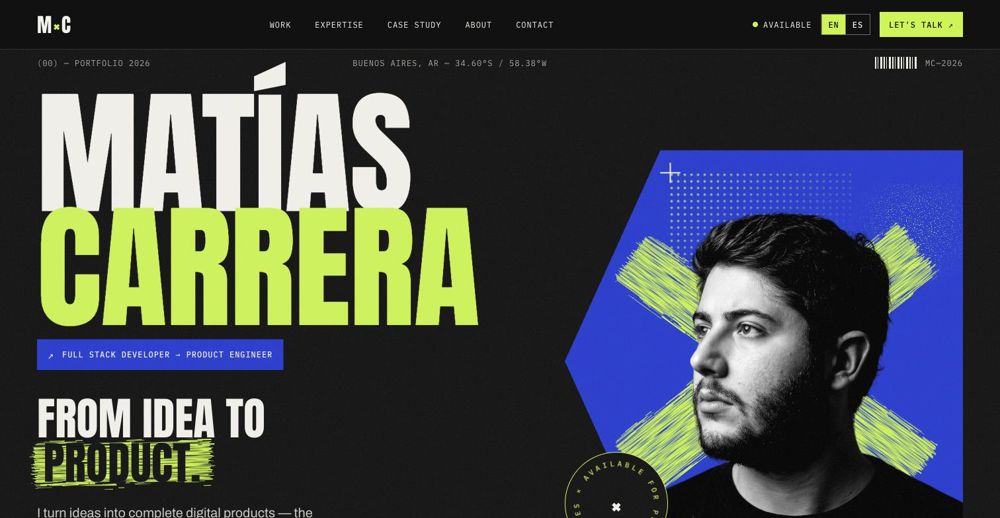

### Hola, soy Matías 👋

Desarrollador Full Stack de Argentina. Estudio Ingeniería en Inteligencia
Artificial en la Universidad de Palermo y vengo del diseño gráfico y
multimedia (3 años en UADE).

Diseño y desarrollo productos web de punta a punta: desde apps con base de
datos y tiempo real hasta sitios rápidos y cuidados para estudios y marcas.
Buscando mi primera experiencia profesional como desarrollador, idealmente remoto.

**Stack principal:** TypeScript, React, Next.js, Astro, Node.js, Tailwind CSS, Supabase, PostgreSQL

🌐 **Portfolio:** [mcarreradev.com](https://mcarreradev.com)

---

### 🚀 Proyectos destacados

**[OneProdex](https://oneprodex.vercel.app)** · Predicciones del Mundial FIFA 2026 con grupos privados, rankings y puntuación en tiempo real
Stack: Next.js · TypeScript · Supabase · API-Football · [Repo](https://github.com/maticarrera12/oneprodex)

**[KiritaAI](https://kiritaai.com)** · Analiza reseñas de Google Play con IA para encontrar quejas y oportunidades, con logros y misiones diarias
Stack: Next.js 15 · IA · Play Store scraper · [Repo](https://github.com/maticarrera12/kiritaai)

**[quetedebo](https://quetedebo.vercel.app)** · PWA que divide gastos de un grupo y calcula las menores transferencias para quedar a mano
Stack: React · Vite · PWA · [Repo](https://github.com/maticarrera12/quetedebo)

**Migala** · CRM para salones de eventos: organización de eventos, personal, pagos, stock y calendario de visitas (en desarrollo)
Stack: Next.js 16 · React 19 · Supabase

---

### 🧩 Sitios para clientes

- **[Estudio Lasalle](https://estudiolasalle.com)** · Sitio para un estudio jurídico familiar, con foco en SEO (Astro)
- **[Counterpoint](https://www.estudiocounterpoint.com)** · Sitio de un estudio de diseño y desarrollo web de Buenos Aires (Astro · Tailwind CSS)

### 🎨 Proyectos conceptuales

- **[MIMI & CO.](https://gelato-landing-mu.vercel.app)** · Landing de un laboratorio de helados con historia 3D controlada por scroll · [Repo](https://github.com/maticarrera12/gelato-landing)
- **[pausa](https://pausa-sigma.vercel.app)** · Tienda conceptual en Astro puro, con carrito, filtros y paneles, sin framework de UI · [Repo](https://github.com/maticarrera12/pausa)
- **[UMBRAL](https://umbral-eight-theta.vercel.app)** · Sitio para un estudio de arquitectura residencial (Astro)
- **[FUERA©](https://fuera-streetwear.vercel.app)** · E-commerce conceptual de una marca de streetwear independiente (Astro)

---

### 📍 Dónde encontrarme

- 🌐 [Portfolio](https://mcarreradev.com)
- 💼 [LinkedIn](https://www.linkedin.com/in/matias-carrera/)
- 🐦 [X / Twitter](https://x.com/mcarreradev)
- 📧 mcarreradev12@gmail.com

---

*Diseñador convertido a developer. Me interesa el cruce entre código limpio
y buena experiencia de usuario.*
